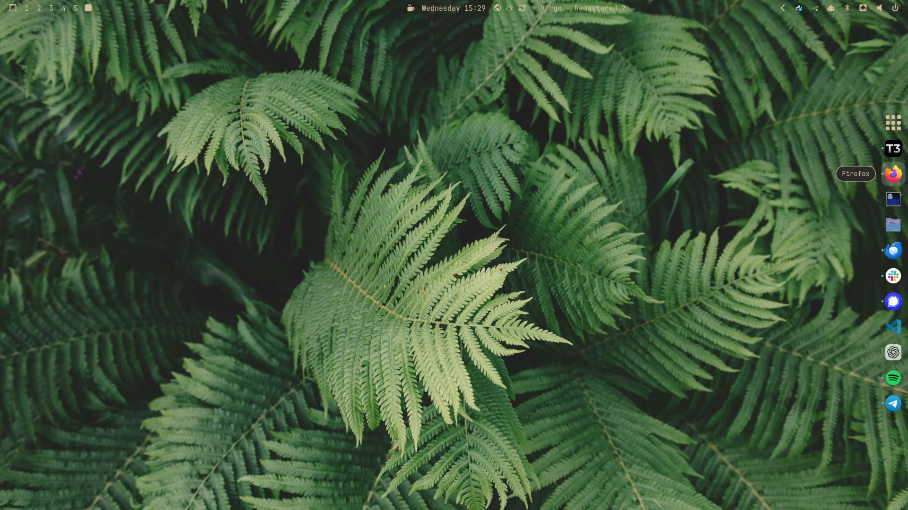

# Side Dock for Omarchy

An always-on dock for [Omarchy](https://omarchy.org) in the style of Ubuntu's
GNOME dock: favourite apps plus every running app, one click to jump to it. It
sits on any screen edge, on every workspace, and keeps working in tiling and
scrolling layouts.



It is a fork of Omarchy's own dock (`omarchy.dock`). Omarchy's dock only
appears on floating workspaces, because a tiled workspace is expected to lay
windows out by itself. Without a dock, though, apps like Slack, Telegram and
Spotify sit on some workspace with no hint of where to find them.

Made for Omarchy 4 (its Quickshell shell and Hyprland's Lua config); tested
with Omarchy 4.0.0.alpha, Hyprland 0.57.1 and Quickshell 0.3.2. It needs
nothing beyond Omarchy itself; only the tests need a few tools (see Testing).

## Install

```sh
omarchy plugin add https://github.com/mitschabaude/omarchy-side-dock.git --enable
```

Enabling it switches Omarchy's dock off, since this plugin declares itself a
clone of it. Everything that talks to Omarchy's dock talks to this one instead:
Super+Alt+Space (the app grid), `omarchy dock position|autohide|pinned`, and
the Appearance menu.

Update with `omarchy plugin update mitschabaude.side-dock`. To go back to
Omarchy's dock, run `omarchy plugin remove mitschabaude.side-dock`.

## Settings

The `dock` section of `~/.config/omarchy/shell.json`, shared with Omarchy's
dock:

```json
"dock": {
  "position": "right",
  "autohide": false,
  "monitors": ["DP-1"],
  "pinned": ["firefox.desktop", "slack.desktop", "org.telegram.desktop.desktop"],
  "labels": { "com.t3tools.T3Code": "T3 Code" }
}
```

- `position` and `autohide` work as in Omarchy's dock (`omarchy dock position
  right`, `omarchy dock autohide on`, or the Appearance menu).
- `monitors` lists the monitors the dock shows on, by the names
  `hyprctl monitors` prints. Leave it out, or empty, for every monitor.
- `pinned` holds desktop ids, each saved with a `.desktop` suffix (see below).
  Pin, unpin and reorder in the dock itself: drag an icon, or right-click it.
  Read the current list with `omarchy dock pinned`.
- `labels` maps a desktop id to the name its hover label shows, for apps whose
  own name is unhelpful.

The dock picks up changes to the file right away.

## What's different from Omarchy's dock

Every change is marked `Local change` in the code. `git diff upstream main`
shows them all.

- **Every workspace.** `DockWindow.qml` drops the floating-workspace condition
  from `shown`. It still hides for fullscreen windows, and auto-hides for
  maximized ones.
- **Reserved space.** The dock reserves its strip (`exclusiveZone`) while it is
  shown and not auto-hiding, so tiled windows sit beside it instead of under it.
- **Chosen monitors.** The `monitors` setting.
- **Reads `shell.json` itself.** The shell gives cloned plugins a restricted API
  without `shellConfig`, so Omarchy's code would see no settings at all and
  fall back to the bottom edge with no pins. `Dock.qml` reads the `dock`
  section through a `FileView` that watches the file.
- **Its own app library.** The shell hands its app library (the app list, its
  search, icons and launching) only to plugins of the `menu` kind, so a clone
  gets none, and the app grid would list no apps, whatever you typed.
  `Dock.qml` loads an instance of Omarchy's `AppLibrary` from the shell's
  `services` folder instead, so it follows Omarchy's updates. Apps from the
  dock and the grid start as from Omarchy's dock, with the "Launching" notice.
- **Pins survive `.desktop` ids.** Both `omarchy-dock` and the dock's
  `normalizeId` strip one `.desktop` suffix. Telegram's id is
  `org.telegram.desktop`, so it used to be saved as `org.telegram`, which
  matches no app. The dock now saves each pin with two suffixes, so one is
  stored and the id reads back intact. Pinning from the CLI has the same
  problem: use `omarchy dock pin org.telegram.desktop.desktop.desktop`, or
  edit `shell.json`.
- **Hidden entries keep their windows.** Omarchy's dock ignores windows whose
  desktop entry is `NoDisplay`. T3 Code's windows, for example, belong to the
  hidden `com.t3tools.T3Code` entry, so its icon never knew T3 Code was
  running, and a click started it again. A pinned entry now claims its
  windows even when hidden.
- **Focus over Hyprland's socket.** A click used to spawn `bash -lc` running
  `hyprctl dispatch` twice. It now sends the same Lua dispatches
  (`hl.dsp.focus`, `hl.dsp.window.alter_zorder`) in-process with
  `Hyprland.dispatch`, the way Omarchy's notifications plugin focuses windows.
- **The pointer stays put.** Hyprland warps the cursor to a newly focused
  window, and Omarchy also warps it on workspace changes
  (`cursor.warp_on_change_workspace`). The dock sends its steps as one Lua
  function that turns both warps off, focuses the window, and restores the
  previous settings, inside `pcall` so a failing step cannot leave them off.
  Keyboard navigation keeps its warps.
- **Smaller icons.** `iconSize` is 30 instead of 36 (`DockWindow.qml`).
- **Running dots, as in Ubuntu's dock.** Measured from Ubuntu 24.04's dock
  (the `DOTS` indicator style in `appIconIndicators.js`, with the Yaru shell
  theme): an icon sits in a box with 6 px padding at 36 px icons, and each
  window adds a dot, up to four, of radius box / 22, half a dot apart, inside
  that box. They are scaled to the 30 px icons and filled with the theme
  accent where Ubuntu uses its orange. Ubuntu puts them on the screen-edge
  side; here they face the windows (left of the icons on a right-hand dock).
  Omarchy's dock only fades closed pins (`idleOpacity`, 0.7).
- **Focus and hover highlight, as in Ubuntu's dock.** The app holding focus,
  and any item under the pointer, gets a rounded box behind its icon (radius
  12 at 36 px icons, white at 20 %), fading over 100 ms as in the Yaru theme.
  Icons no longer grow on hover; only a dragged icon still lifts.
- **Hover labels, as in GNOME.** Ported from `Dash._syncLabel` in GNOME
  Shell 46 (`DASH_ITEM_HOVER_TIMEOUT` 300 ms, label show 150 ms, hide
  100 ms): an item's name appears after the pointer rests on it for 300 ms.
  Once one label has shown, the next item's label appears at once, until the
  pointer has been off the items for 300 ms. The label is GNOME's pill
  (6 × 12 px padding, 1 px border, 10 px from the item, centred on it) in the
  theme's tooltip colours. The apps button reads "Show Apps".
- **Label overrides.** The `labels` setting. T3 Code, for example, rewrites
  its own desktop file (named "T3 Code (Beta)") while it runs.
- **Scratchpad windows count.** Omarchy's dock leaves windows on special
  workspaces out. Here they get dots like any other, and clicking the icon
  opens the scratchpad with that window focused; clicking another app closes
  the scratchpad again.

## Following Omarchy's dock

The `upstream` branch holds Omarchy's dock unchanged, from
`shell/plugins/dock` in [omacom/omarchy](https://github.com/omacom/omarchy),
and `main` merges it. Its commit names the Omarchy commit it comes from. To
take in Omarchy's later changes, copy the new files onto `upstream`, commit
with the Omarchy commit they come from, and merge:

```sh
git switch upstream
cp "$OMARCHY_PATH"/shell/plugins/dock/* .
git commit -am "Omarchy's dock, as of omacom/omarchy@<commit>"
git switch main
git merge upstream
```

`pacman -Q omarchy-dev` names the installed commit: `4.0.0.r7697.gceb30ed`
is `ceb30ed`. Keep `manifest.json` from `main` when the merge conflicts on it.

## Testing

`tests/app-grid.sh` checks the dock without touching the desktop in use, and
saves screenshots of the app grid before and after a search:

```sh
tests/app-grid.sh foot
```

It checks that the dock shows only on the monitor in `monitors`, that the grid
opens there, and that the dock loaded Omarchy's app library.
`tests/hidden-desktop.sh` does the setup: a second Hyprland with its own
D-Bus, drawing only to two virtual monitors (`TEST-A`, `TEST-B`) from a window
on a hidden special workspace, with the dock running in a Quickshell of its own
and a test `shell.json`. `hidden-desktop.sh run <cmd>` runs a command inside
it; `hidden-desktop.sh dock <call>` calls the dock's IPC. It needs `foot`,
`wtype`, `grim` and `jq`.

Clicks on the dock are tested on the desktop in use, since what matters is
how fast a real click focuses a real app. The scripts take over the mouse and
window focus, so run them while nobody else is using the machine, and only for
changes to the click path. Your own mouse use during a run shows up as misses
and moved cursors. Restart the shell first (`omarchy restart shell`): after hot
reloads the dock got slow (0.6–1.3 s per click) and missed clicks, while the
same code took about 10 ms after a clean restart.

- `tests/click.sh <x> <y> <class>` moves the cursor to a point with
  Hyprland's `hl.dsp.cursor.move`, clicks there with
  [wlrctl](https://git.sr.ht/~brocellous/wlrctl) (a virtual pointer, no root
  daemon), and reports the milliseconds until `hyprctl activewindow` has the
  expected class. It fails if the click moved the cursor.
- `tests/suite.sh <x> <class>=<y>...` clicks through running apps for several
  rounds, each click starting from a different focused window.

Coordinates are global. Read icon positions off a screenshot
(`grim -o <monitor> shot.png`); they shift whenever the number of icons or the
icon size changes. wlrctl is in the AUR (`omarchy pkg aur add wlrctl`); both
scripts look for it on `PATH`, or at `$WLRCTL`.

Develop on a copy outside `~/.config/omarchy/plugins/`: every save under the
plugins directory reloads the running shell's plugins.

## License

MIT. This is a fork of Omarchy's dock, which is MIT-licensed,
Copyright (c) David Heinemeier Hansson (see
[Omarchy's LICENSE](https://github.com/omacom/omarchy/blob/quattro/LICENSE)).
[LICENSE](LICENSE) carries both Omarchy's copyright notice and this fork's,
under the same terms.
